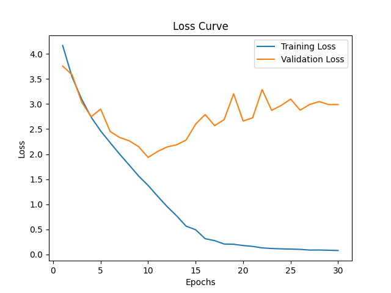
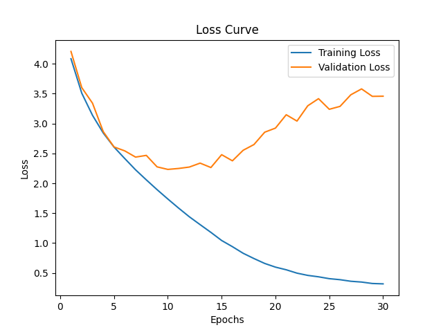
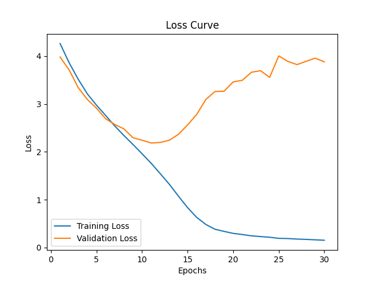
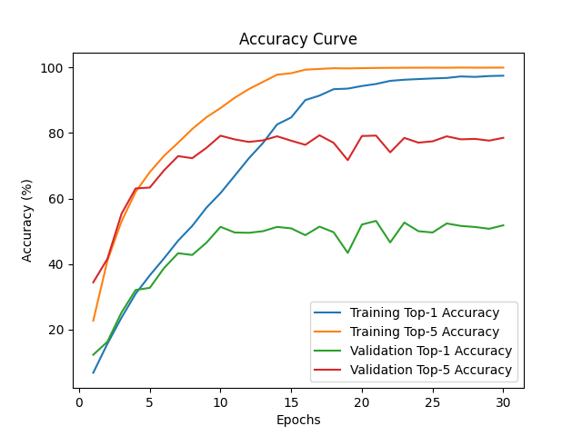
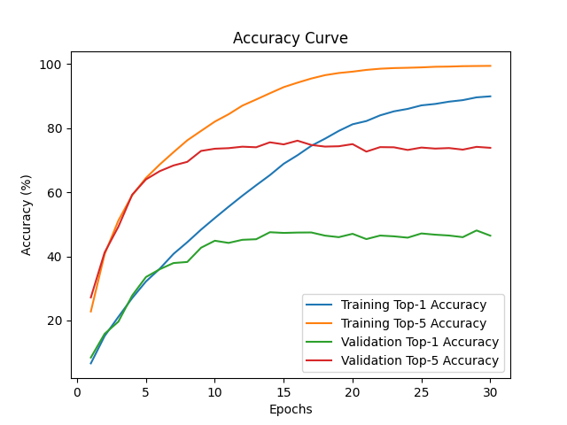
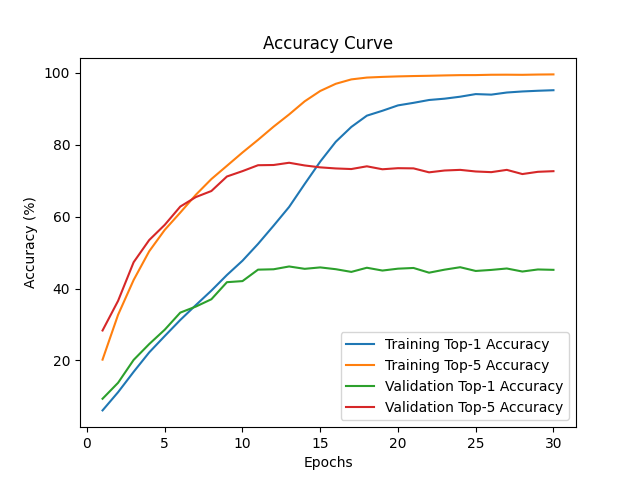
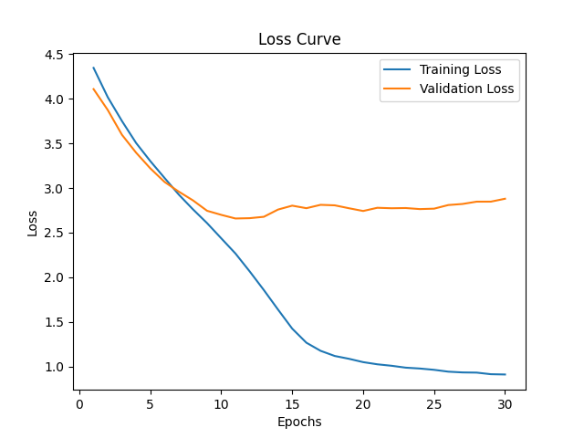
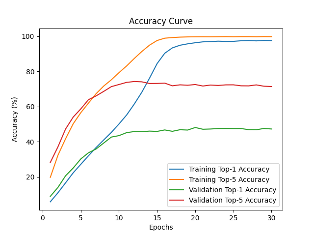

# 图像分类主流模型基准性能对比报告

> **第一周** · Mini-ImageNet-100 · ResNet-50 / MobileNetV3-Large / ConvNeXt-Tiny
>
> 数据来源：`saved_models/` 中最近一次完整实验（2026-10-13 ~ 10-14）保存的 `results.txt` 与 `flops_and_parameters.txt`；延迟为 2026-10-16 在空闲状态下复测。

---

## 1. 实验设置

| 项目 | 配置 |
|---|---|
| 数据集 | Mini-ImageNet-100（100 类）：训练 38,400 / 验证 9,600 / 测试 12,000 张，输入 224×224 |
| 预处理 | Resize → Normalize(0.5, 0.5) → ToTensor |
| 数据增强 | **无** |
| 模型 | ResNet-50 / MobileNetV3-Large / ConvNeXt-Tiny，均为**从零训练**（无预训练权重） |
| 训练 | 30 epoch，batch size 32，Adam，lr = 1e-3（固定），随机种子 seed = 0 |
| 损失函数 | `CrossEntropyLoss` / `CrossEntropyLoss(label_smoothing=0.1)` |
| 模型选择 | 验证损失最小的 epoch |

**延迟的定义**

> **服务端已经持有模型、并且已经把图片张量搬到 GPU 上之后，再跑一次单张（`batch=1`）前向要多久。**

计入：一次前向的全部 kernel 执行时间（含 kernel 之间的**发车空洞**）。
不计入：模型加载、CUDA 上下文初始化、图片读取与解码、预处理、CPU→GPU 拷贝、后处理。

---

## 2. 基准性能对比表

| 模型 | 损失函数 | Test Top-1 | Test Top-5 | Params (M) | MACs (G) | 延迟 CUDA (ms) | 延迟 CPU (ms) |
|---|---|---:|---:|---:|---:|---:|---:|
| **ResNet-50** | CE | **51.05%** | **79.44%** | 23.71 | 4.13 | 4.11 | 17.1 |
| MobileNetV3-Large | CE | 44.13% | 74.30% | 4.33 | 0.23 | 3.91 | **7.1** |
| ConvNeXt-Tiny | CE | 45.67% | 74.73% | 27.89 | 4.46 | 4.33 | 14.4 |
| ConvNeXt-Tiny | **LS(α=0.1)** | **46.36%** | 74.46% | 27.89 | 4.46 | — | — |

**关键结论**

1. **ResNet-50 精度最高**：Test Top-1 领先 ConvNeXt-Tiny 5.38 pt、领先 MobileNetV3-Large 6.92 pt。
2. **MobileNetV3-Large 性价比最高**：精度只低 6.92 pt，参数量仅为 ResNet-50 的 **1/5.5**、MACs 为 **1/17.7**，CPU 延迟快 **2.4 倍**。
3. **ConvNeXt-Tiny 未兑现架构优势**：参数量与算力最大，精度却最低。它更依赖大规模数据与强增强，本实验只有 3.84 万张训练图且零增强。
4. **CUDA 延迟不能用于比较模型**：三模型只差 11%（MACs 却差 19 倍）—— batch=1 时每次前向要发 208~236 个 kernel，单次 launch 约 4.86 µs，构成约 1.1 ms 的固定成本，MobileNetV3 的 GPU 利用率仅 19%。

---

## 3. 训练曲线

**三个模型（Cross-Entropy）**

| ResNet-50 | MobileNetV3-Large | ConvNeXt-Tiny |
|---|---|---|
|  |  |  |
|  |  |  |

三个模型都严重过拟合：训练 Top-1 达 **89.9% ~ 97.5%**，验证 Top-1 最高只有 **48.07%**，差距 **41.8 ~ 49.5 pt**。训练损失单调降到 0.08 ~ 0.32，而验证损失在第 10~11 轮触底后一路上升（ResNet-50 从 1.93 升到 2.99，ConvNeXt 从 2.18 升到 3.88）。

---

## 4. 消融实验：Cross-Entropy vs Label Smoothing

固定 ConvNeXt-Tiny，其余超参数完全一致（30 epoch、seed=0），仅把损失函数换成 `label_smoothing=0.1`（α = 0.1，C = 100）。

| 指标 | Cross-Entropy | Label Smoothing | 变化 |
|---|---:|---:|---:|
| **Test Top-1** | 45.67% | **46.36%** | **+0.69 pt** |
| Test Top-5 | 74.73% | 74.46% | −0.27 pt |
| 最优 Val Top-1 | 46.14% (ep13) | **48.07%** (ep20) | **+1.93 pt** |
| 末轮 Train Top-1 | 95.21% | 97.52% | +2.31 pt |
| **Train − Val 差距** | **49.07 pt** | **49.45 pt** | 基本不变 |
| Val Loss 第 11 轮 → 第 30 轮 | 2.18 → **3.88**（+78%） | 2.66 → **2.88**（+8%） | 明显抑制 |

| Cross-Entropy | Label Smoothing (α=0.1) |
|---|---|
|  |  |
|  |  |

**结论**

1. Label Smoothing 带来**小幅正收益**：Test Top-1 +0.69 pt，最优 Val Top-1 +1.93 pt。
2. 它明显**抑制了验证损失的后期劣化**（+8% vs +78%）。
3. 但 **Train−Val 差距并未缩小**（49.07 → 49.45 pt）。α=0.1、C=100 时 LS 的理论训练损失下界为 0.7778，而实测末轮训练损失 0.9122 —— 模型在训练集上依然几乎完全拟合。因此本实验**不支持**「LS 显著缓解过拟合」的说法，它更像一种温和正则化 + 置信度校准手段。
4. 两种损失函数的**数值不可直接比较**（LS 的目标分布本身带非零下界），结论只能建立在准确率上。
5. 局限：只有 1 个 seed，+0.69 pt 无法与随机波动区分。

---

